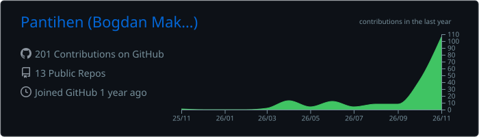
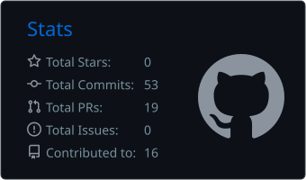
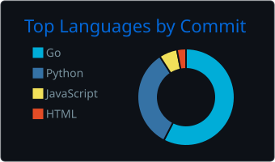
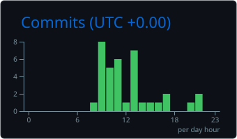

<!-- ═══════════════════════════  HEADER  ═══════════════════════════ -->
<p align="center">
  
</p>

<p align="center">
  <a href="https://github.com/Pantihen">
    
  </a>
</p>

<p align="center">
  
  
  
</p>

<!-- ═══════════════════════════  BOOT  ═══════════════════════════ -->

```console
pantihen@github:~$ figlet -f "ANSI Shadow" pantihen

██████╗  █████╗ ███╗   ██╗████████╗██╗██╗  ██╗███████╗███╗   ██╗
██╔══██╗██╔══██╗████╗  ██║╚══██╔══╝██║██║  ██║██╔════╝████╗  ██║
██████╔╝███████║██╔██╗ ██║   ██║   ██║███████║█████╗  ██╔██╗ ██║
██╔═══╝ ██╔══██║██║╚██╗██║   ██║   ██║██╔══██║██╔══╝  ██║╚██╗██║
██║     ██║  ██║██║ ╚████║   ██║   ██║██║  ██║███████╗██║ ╚████║
╚═╝     ╚═╝  ╚═╝╚═╝  ╚═══╝   ╚═╝   ╚═╝╚═╝  ╚═╝╚══════╝╚═╝  ╚═══╝

pantihen@github:~$ python manage.py runserver
Watching for file changes with StatReloader
Performing system checks...

System check identified no issues (0 silenced).
Django version 5.x, using settings 'pantihen.settings'
Starting development server at http://127.0.0.1:8000/
Quit the server with CONTROL-C.
```

### `$ curl -s localhost:8000/api/v1/me/ | jq`

```json
{
  "name": "Bogdan Maksimenko",
  "handle": "@Pantihen",
  "role": "Python / Django Backend Developer",
  "about": [
    "Пишу бэкенд на Python и Django",
    "REST API на Django REST Framework, фоновые задачи на Celery",
    "Люблю чистую архитектуру, быстрые запросы и зелёные пайплайны"
  ],
  "stack": {
    "core": ["Python", "Django", "DRF", "FastAPI"],
    "data": ["PostgreSQL", "Redis", "Celery", "RabbitMQ"],
    "ops":  ["Docker", "Nginx", "Gunicorn", "GitHub Actions"]
  },
  "principles": ["select_related > N+1", "tests before deploy", "no deploys on Friday"],
  "status": "☦️ locked in"
}
```

### `$ tail -f /var/log/pantihen/now.log`

```diff
+ [build] DevSpace — соцсеть для разработчиков: Django + DRF + PostgreSQL
+ [build] REST API, JWT/RBAC, фоновые задачи на Celery + Redis
+ [infra] Docker → Gunicorn → Nginx → VPS, CI/CD на GitHub Actions
+ [learn] мониторинг: Prometheus + Grafana, автоматизация через Ansible
@@ next: async Django, профилирование ORM, высокие нагрузки @@
- [never] N+1 запросы в продакшене
- [never] деплой в пятницу вечером
```

<!-- ═══════════════════════════  STACK  ═══════════════════════════ -->

### `$ pip freeze --stack`

<table>
  <tr>
    <td align="center" width="140"><b>🐍 core</b></td>
    <td>
      <br/>
      
      
      
      
      
    </td>
  </tr>
  <tr>
    <td align="center"><b>🗄️ data</b></td>
    <td></td>
  </tr>
  <tr>
    <td align="center"><b>🚀 ops</b></td>
    <td>
      <br/>
      
      
    </td>
  </tr>
  <tr>
    <td align="center"><b>🧰 also</b></td>
    <td></td>
  </tr>
</table>

<!-- ═══════════════════════════  PROJECTS  ═══════════════════════════ -->

### `$ ls -la ~/projects --sort=impact`

| | Проект | Что внутри |
|:-:|:--|:--|
| 🌐 | **[DevSpace](https://github.com/mrDisa/Devspace)** | Соцсеть для разработчиков: посты, лента, роли и права, админка. Django + DRF + PostgreSQL, Docker → Gunicorn → Nginx → VPS. Команда из двух человек |
| ✅ | **[fastapi-task-tracker](https://github.com/Pantihen/fastapi-task-tracker)** | Task Tracker API: PostgreSQL + Alembic, JWT/RBAC, фоновые задачи Celery + Redis, Docker, CI/CD |
| 🐳 | **[fastapi-docker-deploy](https://github.com/Pantihen/fastapi-docker-deploy)** | FastAPI + PostgreSQL + Redis + Celery в Docker, CI на GitHub Actions, деплой на Railway |
| 📈 | **[devops-final](https://github.com/Pantihen/devops-final)** | Docker, мониторинг Prometheus + Grafana, сборка в GHCR через GitHub Actions, раскатка Ansible |
| 📉 | **[Prolongo](https://github.com/mrDisa/Prolongo)** | Анализатор рисков оттока клиентов на Go |
| 📝 | **[kt06](https://github.com/Pantihen/kt06)** | API блог-платформы: Express, Prisma/PostgreSQL, Redis, JWT, RBAC, Socket.io, Swagger, Docker |

<!-- ═══════════════════════════  STATS  ═══════════════════════════ -->

### `$ git log --stats`

<p align="center">
  
</p>

<p align="center">
  
  
</p>

<p align="center">
  
  
</p>

### `$ python manage.py run_snake`

<p align="center">
  <picture>
    <source media="(prefers-color-scheme: dark)" srcset="https://raw.githubusercontent.com/Pantihen/Pantihen/output/github-snake-dark.svg" />
    <source media="(prefers-color-scheme: light)" srcset="https://raw.githubusercontent.com/Pantihen/Pantihen/output/github-snake.svg" />
    
  </picture>
</p>

<!-- ═══════════════════════════  FOOTER  ═══════════════════════════ -->

```console
pantihen@github:~$ exit
logout
Connection to github.com closed. Thanks for visiting! ⭐
```

<p align="center">
  
</p>
