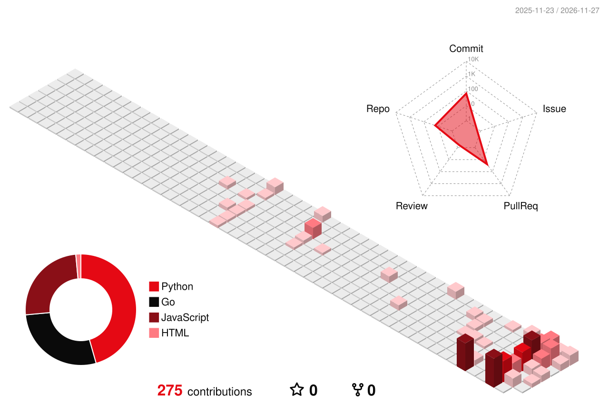

  <picture>
    <source media="(prefers-color-scheme: dark)" srcset="https://raw.githubusercontent.com/Pantihen/Pantihen/main/assets/header-dark.svg" />
    
  </picture>

  I build backends with Python and Django: REST APIs, background jobs, solid databases. 
  Clean architecture, fast queries, predictable deploys.

        

 

  <picture>
    <source media="(prefers-color-scheme: dark)" srcset="https://raw.githubusercontent.com/Pantihen/Pantihen/main/profile-3d-contrib/pantihen-dark.svg" />
    
  </picture>

